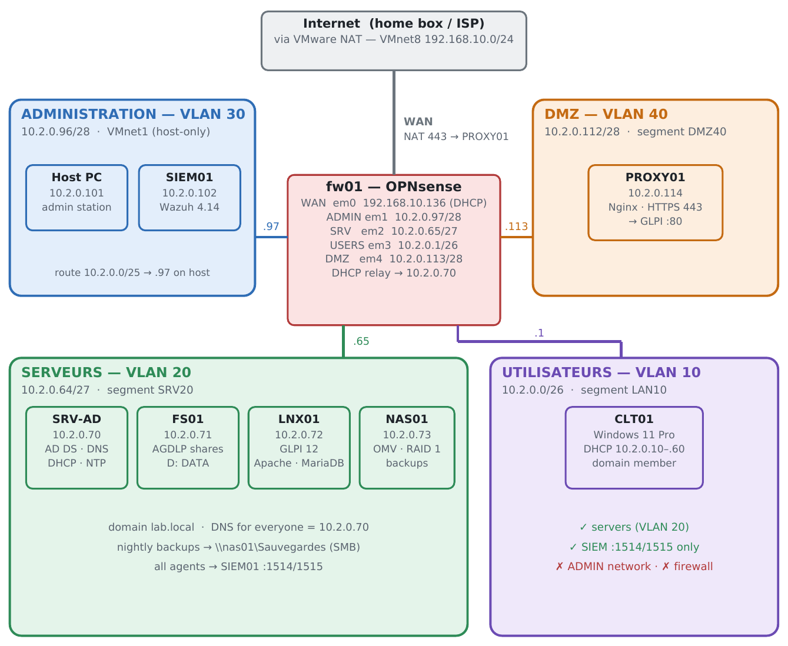
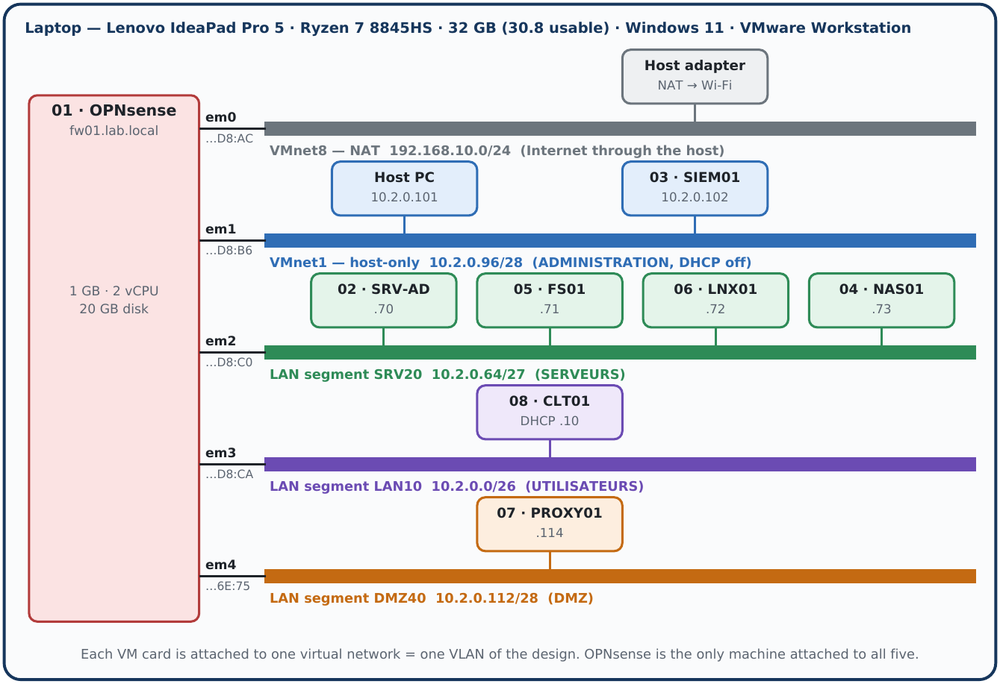
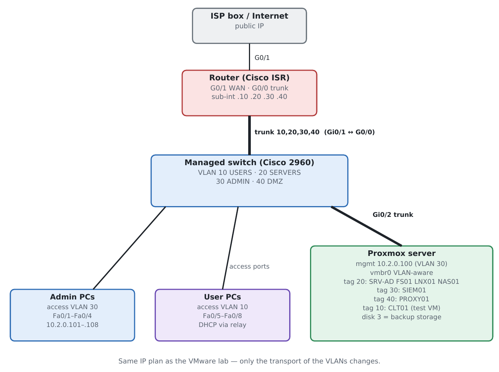

# Home Lab — Small-Business Infrastructure (`lab.local`)

A complete small-business IT infrastructure built from scratch and documented end to end: segmented network with a DMZ, Active Directory, file server with AGDLP permissions, GLPI helpdesk published over HTTPS, NAS with RAID 1 and tested restores, and a Wazuh SIEM.

The network was first built **virtually** (VMware Workstation + OPNsense firewall) and then translated to **real Cisco hardware** (router-on-a-stick, managed switch, Proxmox). Both versions use the same IP plan and the same security rules.

> Inspired by a project from my TSSR training (systems & network administration), rebuilt alone at home and extended with a DMZ, a SIEM, backups and a hardware version.



---

## What the lab provides

| Service | Machine | Technology |
|---|---|---|
| Routing, filtering, NAT, DHCP relay, syslog | fw01 | OPNsense 26.7 — *or* Cisco ISR + Catalyst 2960 |
| Directory, DNS, DHCP, NTP, Group Policy | SRV-AD | Windows Server 2022 |
| File shares with AGDLP permissions | FS01 | Windows Server 2025 |
| Helpdesk and knowledge base (LDAP to AD) | LNX01 | Debian 13 · GLPI · Apache · MariaDB |
| Backup storage (RAID 1) | NAS01 | OpenMediaVault |
| Security monitoring (SIEM) | SIEM01 | Ubuntu Server 26.04 · Wazuh 4.14 |
| Publication of GLPI over HTTPS | PROXY01 (DMZ) | Debian 13 · Nginx reverse proxy |
| User workstation | CLT01 | Windows 11 Pro |

## Network design

`10.2.0.0/24` split with VLSM into four zones — largest need first, default deny between zones.

| Zone | VLAN | Network | Gateway | Who lives there |
|---|---|---|---|---|
| UTILISATEURS (users) | 10 | 10.2.0.0/26 | 10.2.0.1 | workstations — DHCP via relay |
| SERVEURS (servers) | 20 | 10.2.0.64/27 | 10.2.0.65 | AD, file server, GLPI, NAS |
| ADMINISTRATION | 30 | 10.2.0.96/28 | 10.2.0.97 | admin PC, SIEM, device management |
| DMZ | 40 | 10.2.0.112/28 | 10.2.0.113 | reverse proxy only |

Key rules (full tables in [`network/opnsense`](network/opnsense/README.md) and [`network/cisco`](network/cisco)):

- Users reach servers and the Internet, but **never** the admin network or the firewall itself (blocked and logged).
- The only narrow exception from users to admin: Wazuh agent ports to the SIEM.
- The DMZ can reach only DNS, GLPI on port 80 and the SIEM agent ports. Everything else toward the lab is **blocked and logged**.
- From outside, only HTTPS 443 is forwarded — to the reverse proxy, never to GLPI directly.
- Firewall / device management is reachable from the admin network only.

| Track A — virtual (as built) | Track B — real hardware |
|---|---|
|  |  |
| OPNsense VM, one virtual network per VLAN | Router-on-a-stick, 802.1Q trunks, extended ACLs, NAT/PAT, Proxmox VLAN-aware bridge |

## Highlights

- **Active Directory**: OU design, 13 users, AGDLP groups (5 global / 9 domain local), 4 GPOs (password & lockout policy, wallpaper, drive mapping with item-level targeting, CMD restriction), logon hours.
- **Firewall**: aliases, per-zone rules, DHCP relay, destination NAT, GUI restricted to the admin zone, remote syslog to the SIEM.
- **Cisco version**: VLANs, port security, BPDU guard, native VLAN 999, router-on-a-stick with `ip helper-address`, stateless ACLs with `established`, NAT overload + static PAT, SSH-only management with `access-class`, NTP and syslog.
- **GLPI**: secure file layout (config and data outside the web root), LDAP authentication against AD, profiles, ITIL categories, ticket workflow and knowledge base.
- **Backups**: Windows Server Backup to the NAS with a domain service account, Linux backup script with cron (DB dump + files + `glpicrypt.key`), **documented restore test**.
- **SIEM**: Wazuh all-in-one, agents on every machine, firewall syslog ingestion, detection tests (account lockout — rule 60115, repeated blocks / scans — rule 87702).
- **DMZ**: Nginx TLS reverse proxy, isolation verified from the DMZ host.
- **Hardening**: SSH keys only, root login disabled, host firewall (ufw), services listening only where needed.

## Repository contents

```
├─ docs/
│   ├─ HomeLab_Complete_Guide_EN.pdf   full rebuild guide (72 pages) — English
│   ├─ HomeLab_Guide_Complet_FR.pdf    same guide in French
│   ├─ addressing.md                   IP plan, inventory, DNS, web interfaces, flows
│   ├─ acceptance-tests.md             27-test acceptance checklist
│   ├─ diagrams/                       logical and physical diagrams
│   └─ screenshots/                    proof screenshots
├─ network/
│   ├─ opnsense/                       aliases, rules, NAT, relay (track A)
│   ├─ cisco/                          SW-LAB, R-LAB, L3-switch variant (track B)
│   └─ proxmox/                        VLAN-aware bridge configuration
├─ services/                           GLPI (Apache), Nginx, Wazuh, SSH configs
├─ scripts/
│   ├─ linux/                          GLPI backup script, ufw
│   └─ windows/                        AD user creation, share/ACL export, NTP
├─ troubleshooting.md                  real problems met: symptom → cause → fix
└─ ROADMAP.md                          next steps (automation with Python / Ansible)
```

**Start with [`troubleshooting.md`](troubleshooting.md)** — it is the most honest picture of the work: 30 real problems and how each was diagnosed.

## Documentation

The [complete guide](docs/HomeLab_Complete_Guide_EN.pdf) rebuilds the whole lab from an empty computer, step by step, with a check after every step. It has two network tracks (VMware + OPNsense, or Cisco hardware + Proxmox) followed by the shared server chapters, then acceptance tests, operating procedures, known problems and a backup policy. A [French version](docs/HomeLab_Guide_Complet_FR.pdf) is also available.

## Security note

No password, private key or exported firewall configuration is stored in this repository. Configuration files use placeholders such as `<admin-secret>`. All addresses are private RFC 1918 addresses of an isolated lab.

## Skills demonstrated

`Windows Server` `Active Directory` `Group Policy` `DNS` `DHCP` `NTFS / AGDLP` `OPNsense` `Cisco IOS` `VLAN / 802.1Q` `ACL` `NAT / PAT` `Linux (Debian, Ubuntu)` `Apache` `Nginx` `MariaDB` `GLPI` `LDAP` `SSH hardening` `OpenMediaVault` `RAID` `Backup & restore` `Wazuh / SIEM` `VMware` `Proxmox` `Technical documentation (EN / FR)`

## Related certifications

CompTIA A+ · Network+ · Security+ · Microsoft AZ-900 · Cisco CCNA (in progress)
